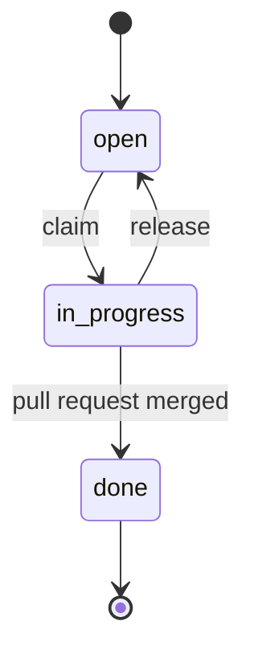

# Tickets

A ticket is one unit of work an agent can claim, finish and merge on its own. Tickets are written in Phase 4 of [plan-feature](SKILL.md) and executed with [implement-feature](../implement-feature/SKILL.md). This file is the format: people, agents and tools (a kanban board, a swarm scheduler) all read tickets by it.

## Size

A ticket is exactly one pull request that passes `cargo rusticate verify` on its own:

- **Never smaller.** "Write the SQL" and "write the handler" as separate tickets leave the tree broken between them.
- **Never larger than one slice.**

| `type` | What it delivers | Usually depends on |
|---|---|---|
| `context` | a new bounded context: `cargo rusticate new domain`, with its ADR already accepted | nothing |
| `engine` | pure rules (`R` IDs) in `<ctx>-engine`, with example and property tests | `context`, if new |
| `migration` | one schema change ([add-migration](../add-migration/SKILL.md)) | `context`, if new |
| `slice` | one `verb_noun` slice end to end: types, `db.rs`, workflow, adapter, error mapping, integration tests, `openapi.json` | the `engine` and `migration` tickets it uses, and any earlier slice it builds on |

Every slice in `design.md` has exactly one `slice` ticket. Engine rules that only one slice uses may stay in that slice's ticket. Split them into an `engine` ticket when several slices share them, or when they are big enough to build in parallel.

## File

One file per ticket: `features/<NNN-slug>/tickets/<id>.md`, for example `features/004-consent/tickets/CONS-T03.md`. Copy it from [templates/ticket.md](templates/ticket.md).

The front matter is strict YAML. Every key is present, and the order is as shown; a value that does not apply is `null` or `[]`, never missing.

```yaml
---
id: CONS-T03               # <scenario key>-T<NN>; never reused or renumbered
feature: 004-consent       # the folder name
title: Grant consent for a purpose
type: slice                # context | engine | migration | slice
status: open               # open | in_progress | done
depends_on: [CONS-T01, CONS-T02]   # ticket IDs, possibly of other features
slice: grant_consent       # slice tickets only, otherwise null
rules: [R1, R2]            # spec rules this ticket implements
scenarios: [CONS-S01, CONS-S02]    # spec scenarios its tests prove
touches: [crates/domains/consent, apps/api/openapi.json]  # crates and shared files it changes
assignee: null             # who holds it while in_progress
pr: null                   # pull request number, once opened
---
```

The body has four sections, in this order:

- `## Goal`: one sentence.
- `## Acceptance`: a checklist. Every ticket includes the standard items in the template; a `slice` ticket also lists the slice's standard tests.
- `## Read first`: links to the spec rules, the design row and the decisions this ticket needs. An agent reads these and nothing else from the feature.
- `## Log`: append-only. One dated line per event (claimed, blocked, scope question, PR opened), written by whoever acted.

## State



| Transition | Allowed when | Write |
|---|---|---|
| `open → in_progress` (claim) | every `depends_on` ticket is `done`, and no `in_progress` ticket shares an entry in `touches` | `status`, `assignee`, a log line |
| `in_progress → open` (release) | the agent stops without finishing | `status`, `assignee: null`, a log line saying why and what is left |
| `in_progress → done` | `verify` passes and every acceptance item is ticked | `status: done` and `pr`, committed in the ticket's **own** pull request, so the merge is what makes it true |

- **Blocked is not a state.** It is derived: an `open` ticket with a `depends_on` ticket that is not `done`. A board can show it from the graph.
- **`done` is final.** A bug or change found later becomes a new ticket that links to the old one in its log.
- **Scope changes are not made silently.** If a ticket cannot be done as written (wrong split, missing rule, spec wrong), the agent logs it, releases the ticket, and asks the human. Only the human changes a ticket's scope, rules or scenarios.

The feature's status in `features/README.md` follows its tickets. It becomes `building` when the first ticket is claimed. It becomes `done` when every ticket is `done` and the human agrees the feature is complete; that index change goes in the last ticket's pull request, or in a small docs pull request.

## Checks before the tickets are approved

- [ ] every slice in `design.md` has exactly one `slice` ticket;
- [ ] every rule appears in at least one ticket, and every scenario in exactly one;
- [ ] every `depends_on` ID exists, and the graph has no cycles;
- [ ] tickets that can run in parallel do not share a `touches` entry, or the overlap is intended (and they will run one after another);
- [ ] every front matter key is present, and every ticket is `open` with `assignee: null` and `pr: null`.

## Known gaps (for a future task manager or kanban)

Until a task manager exists, the human (or one coordinating agent) assigns tickets. Agents do not claim tickets on their own in parallel. A tool built on this format should close these gaps:

- **Claims are not atomic.** A claim (`status: in_progress`, `assignee`) is written in the ticket file on the agent's branch, so it is invisible on `main` and to other agents until pushed. Two agents can claim the same ticket. The task manager must own claims: one place where a claim either succeeds or fails, which then writes the same fields. The `touches` overlap check needs the same atomicity.
- **`in_progress` is not visible on `main`.** `main` only ever shows `open`, then `done` (the merge). A board should derive `in_progress` from the task manager's claims, or from open pull requests on the ticket's branch.
- **Nothing validates the format yet.** The front matter keys, the allowed values, existing `depends_on` IDs, the absence of cycles, and every scenario being in exactly one ticket are checked by hand (see the checks above). A `tickets check` command (for example in `xtask`) should validate them, and run in `verify` or CI.
- **Abandoned claims are not detected.** An agent that dies while a ticket is `in_progress` never releases it. The task manager needs a timeout or heartbeat that releases it, with a log line.
- **Cross-feature dependencies are not resolved.** `depends_on` may name another feature's ticket, so a tool must index all `features/*/tickets/` to resolve them.
